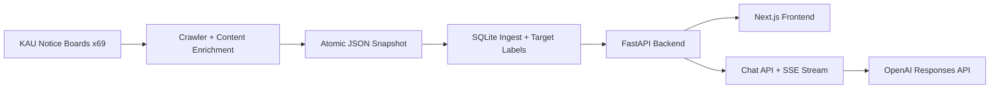

# KAU Notice Hub

한국항공대학교 곳곳에 흩어진 공지를 한곳에서 수집하고, 나에게 해당하는 공지만 골라 보며, AI 챗봇으로 빠르게 찾아볼 수 있도록 만드는 공지 통합 플랫폼입니다.

**서비스 주소: [kau-notice-hub.app](https://kau-notice-hub.app)**

## Overview

KAU 주요 게시판 **69개**를 단일 스키마로 수집해 전체 공지 스냅샷을 유지하고, 이를 SQLite DB로 atomic ingest해 FastAPI 백엔드, Next.js 프론트엔드, OpenAI 기반 RAG 챗봇으로 제공합니다. 백엔드는 AWS Lightsail에 Docker Compose로 배포되어 내장 크롤러가 3시간마다 공지를 갱신하고, 프론트엔드는 Vercel에 배포됩니다.

## Repositories

| 저장소 | 설명 |
| --- | --- |
| [KAU-Notice-Hub-BackEnd](https://github.com/KAU-HUB-Official/KAU-Notice-Hub-BackEnd) | FastAPI API 서버, 내장 크롤러, SQLite ingest, RAG 챗봇, 카카오 로그인·북마크 |
| [KAU-Notice-Hub-FrontEnd](https://github.com/KAU-HUB-Official/KAU-Notice-Hub-FrontEnd) | Next.js 14 웹 프론트엔드 (백엔드 API 프록시 BFF) |
| [KAUWebCrawler](https://github.com/KAU-HUB-Official/KAUWebCrawler) | 초기 독립 크롤러 (보관됨). 현재 운영 크롤러는 BackEnd의 `app/crawler/`에 통합 |

## Architecture



API는 SQLite를 우선 읽고, DB가 없거나 스키마가 다르면 JSON 스냅샷에서 자동 부트스트랩, 그래도 실패하면 JSON repository로 폴백합니다.

## Features

- **공지 탐색**: 공지 대상(학부재학생, 신입생·편입생, 일반대학원생, 특수대학원생, 교직원·기타), 게시판, 중분류, 세부 홈페이지 필터와 검색. 필터 상태는 URL로 공유됩니다.
- **공지 대상 라벨**: 새 공지에 게시판 규칙과 LLM으로 "누구에게 해당하는 공지인지" 라벨을 붙입니다.
- **RAG 챗봇**: 질문 분기(검색 / 이전 대화 / 범위 밖) → 키워드 검색 → LLM rerank → 답변. 고른 공지 대상 안에서 찾고, 이전 대화(`history`)와 SSE 단계 스트리밍을 지원합니다. 학생들이 쓰는 표현과 공지 표현이 다른 경우(예: 긱사 ↔ 기숙사)는 동의어 사전으로 맞춥니다.
- **본문 보강**: 이미지·HWP로만 올라온 공지는 본문을 텍스트로 옮겨 검색과 챗봇에서 찾을 수 있게 합니다.
- **개인정보 보호**: 공지 본문, 검색 색인, LLM 입력에서 학번과 사람 이름을 가립니다.
- **카카오 로그인·북마크**: 로그인하면 공지를 북마크하고 모아 볼 수 있습니다.

## Tech Stack

- **Crawling**: Python, requests, BeautifulSoup, unhwp (HWP/HWPX 파싱, MIT)
- **Backend**: FastAPI, Pydantic, SQLite(atomic ingest) + JSON 스냅샷 fallback
- **Frontend**: Next.js 14 App Router, TypeScript, Tailwind CSS, Markdown renderer
- **AI / RAG**: OpenAI Responses API, 키워드 검색 기반 RAG(임베딩·벡터 DB 미사용), LLM rerank, SSE 스트리밍
- **Privacy**: 정규식(학번) + KoELECTRA NER 파인튜닝 모델(이름, onnxruntime)
- **Infra**: Docker Compose, Caddy, AWS Lightsail, GitHub Actions 자동 배포, Vercel
- **Quality**: pytest, 챗봇 분기 검증·RAGAS 평가, k6 부하 테스트

## Quick Start

```bash
# 1. BackEnd
git clone https://github.com/KAU-HUB-Official/KAU-Notice-Hub-BackEnd.git
cd KAU-Notice-Hub-BackEnd
python3 -m pip install -e '.[dev]'
uvicorn app.main:app --reload --port 8000

# 2. FrontEnd
git clone https://github.com/KAU-HUB-Official/KAU-Notice-Hub-FrontEnd.git
cd KAU-Notice-Hub-FrontEnd
yarn install && yarn dev
```

브라우저에서 `http://localhost:3000`으로 접속합니다. RAG 챗봇을 켜려면 BackEnd `.env`에 `RAG_ENABLED=true`와 `OPENAI_API_KEY`를 설정합니다(둘 중 하나라도 없으면 로컬 키워드 검색으로 폴백). 자세한 실행·배포 방법은 각 저장소의 README를 참고하세요.

## Development

- `main`은 배포 브랜치입니다. 작업 브랜치 → PR → squash merge로만 반영합니다.
- BackEnd는 PR이 `main`에 머지되면 GitHub Actions가 Lightsail에 자동 배포합니다(문서만 바뀐 머지는 배포하지 않음). FrontEnd는 Vercel이 배포합니다.

## Documentation

- **BackEnd**: [README](https://github.com/KAU-HUB-Official/KAU-Notice-Hub-BackEnd/blob/main/README.md) · [Project Structure](https://github.com/KAU-HUB-Official/KAU-Notice-Hub-BackEnd/blob/main/docs/PROJECT_STRUCTURE.md) · [API Spec](https://github.com/KAU-HUB-Official/KAU-Notice-Hub-BackEnd/blob/main/docs/API_SPEC.md) · [RAG](https://github.com/KAU-HUB-Official/KAU-Notice-Hub-BackEnd/blob/main/docs/RAG_PLAN.md) · [RAG Evaluation](https://github.com/KAU-HUB-Official/KAU-Notice-Hub-BackEnd/blob/main/docs/RAG_EVALUATION.md) · [Privacy Masking](https://github.com/KAU-HUB-Official/KAU-Notice-Hub-BackEnd/blob/main/docs/PRIVACY_MASKING.md) · [Deployment](https://github.com/KAU-HUB-Official/KAU-Notice-Hub-BackEnd/blob/main/docs/DEPLOYMENT.md) · [ERD](https://github.com/KAU-HUB-Official/KAU-Notice-Hub-BackEnd/blob/main/docs/ERD.md) · [Crawler Docs](https://github.com/KAU-HUB-Official/KAU-Notice-Hub-BackEnd/blob/main/docs/crawler/README.md)
- **FrontEnd**: [README](https://github.com/KAU-HUB-Official/KAU-Notice-Hub-FrontEnd/blob/main/README.md) · [Classification](https://github.com/KAU-HUB-Official/KAU-Notice-Hub-FrontEnd/blob/main/docs/CLASSIFICATION.md) · [Chatbot](https://github.com/KAU-HUB-Official/KAU-Notice-Hub-FrontEnd/blob/main/docs/CHATBOT.md) · [Deployment](https://github.com/KAU-HUB-Official/KAU-Notice-Hub-FrontEnd/blob/main/docs/DEPLOYMENT.md)

## Goals

분산된 학교 공지를 단순히 모으는 데서 그치지 않고, 사용자 질문과 운영 데이터를 기반으로 점진 개선되는 공지 지식 시스템을 지향합니다. 재학생·대학원생·교육원 수강생·취업 준비생 모두 자신에게 필요한 공지를 한곳에서 놓치지 않고 확인할 수 있도록 만드는 것이 목표입니다.
